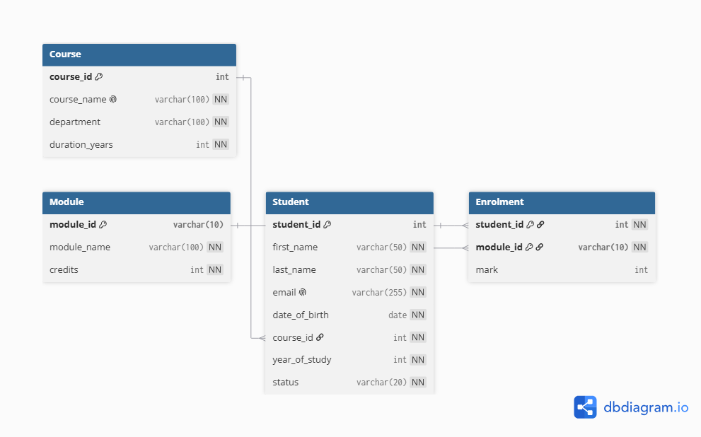

# University Records Database

A relational database for managing students, courses, modules and enrolments, built with SQL Server (T-SQL). The project follows the full workflow from design to querying: a constrained schema, seed data, CRUD operations, constraint tests, joins, aggregates, subqueries, CTEs, views, an index and transactions.



## What this project demonstrates

- **Schema design:** four normalised tables with primary keys, foreign keys, `UNIQUE`, `CHECK` and `DEFAULT` constraints, and a junction table resolving a many-to-many relationship
- **Data integrity:** a script that deliberately breaks each type of constraint and captures the error
- **Querying:** `INNER` and `LEFT JOIN`, `GROUP BY` / `HAVING`, `CASE`, `IN` / `EXISTS` / `NOT EXISTS` subqueries, CTEs, and string, null and date functions
- **Reusable logic:** two views for student performance and module results
- **Performance and safety:** a non-clustered index, plus transactions that commit on success and roll back on failure

## Tech

- SQL Server (T-SQL)
- Works in SQL Server Management Studio, Azure Data Studio, or Visual Studio's SQL Server Object Explorer
- ERD created with [dbdiagram.io](https://dbdiagram.io)

## Database design

| Table | Purpose | Key constraints |
|---|---|---|
| `Course` | Degree programmes | PK `course_id`; `course_name` unique; `duration_years` between 1 and 6 |
| `Student` | Student records | PK `student_id`; `email` unique; FK to `Course`; `year_of_study` at least 1; `status` limited to Active, Suspended, Graduated or Withdrawn (default Active) |
| `Module` | Modules a student can take | PK `module_id` (e.g. `CS101`); `credits` greater than 0 |
| `Enrolment` | Which student takes which module, and their mark | Composite PK (`student_id`, `module_id`); FKs to `Student` and `Module`; `mark` between 0 and 100, nullable |

**Relationships**

- One course has many students
- One student has many enrolments, and one module has many enrolments
- Students and modules are therefore many-to-many, resolved through `Enrolment`

### Design decisions

- **Composite primary key on `Enrolment`:** a student cannot be enrolled in the same module twice.
- **Nullable `mark`:** `NULL` means "not graded yet", which is different from a mark of 0. Queries that calculate results filter with `mark IS NOT NULL`, and averages use `mark * 1.0` to avoid integer division.
- **`CHECK` constraints instead of lookup tables:** `status` is a short fixed list, so a `CHECK` keeps the schema simple. A lookup table would be better if the list needed to change often.
- **No cascading deletes:** you cannot delete a course that still has students, or a student with enrolments. This protects records, and the CRUD script deletes child rows first.
- **Readable and explicit keys:** module ids like `CS101` are meaningful, and student and course ids are set manually so the seed data has stable ids.

## Repository structure

```
university-records-database/
├── docs/
│   └── erd.png
├── sql/
│   ├── 00_create_database.sql
│   ├── 01_schema.sql
│   ├── 02_seed.sql
│   ├── 03_crud.sql
│   ├── 04_constraint_tests.sql
│   ├── 05_queries_basic.sql
│   ├── 06_queries_joins.sql
│   ├── 07_queries_aggregates.sql
│   ├── 08_queries_subqueries.sql
│   ├── 09_queries_functions.sql
│   ├── 10_views.sql
│   └── 11_indexes_transactions.sql
├── .gitignore
└── README.md
```

## Getting started

**Prerequisites:** SQL Server (the free Developer or Express edition, or LocalDB) and a tool to run scripts, such as SQL Server Management Studio.

1. Clone the repository:
   ```bash
   git clone https://github.com/pedronatanie1/university-records-database.git
   ```
2. Connect to your SQL Server instance.
3. Run the scripts in `sql/` **in numerical order**, from `00` to `11`.

To run them all from PowerShell with `sqlcmd` (adjust the server name if needed):

```powershell
Get-ChildItem sql\*.sql | Sort-Object Name | ForEach-Object {
    sqlcmd -S "(localdb)\MSSQLLocalDB" -E -i $_.FullName
}
```

**Starting again from scratch:** drop the database and rerun everything from script `00`.

```sql
USE master;
GO
ALTER DATABASE UniversityRecordsDB SET SINGLE_USER WITH ROLLBACK IMMEDIATE;
DROP DATABASE UniversityRecordsDB;
GO
```

## What each script does

| Script | Description |
|---|---|
| `00_create_database.sql` | Creates `UniversityRecordsDB` if it doesn't exist |
| `01_schema.sql` | Drops and recreates the four tables with all constraints |
| `02_seed.sql` | Inserts 4 courses, 4 modules, 18 students and 45 enrolments |
| `03_crud.sql` | Insert, select, update and delete examples for every table. Each change is previewed with a `SELECT` first. Note that the updates change some seed rows |
| `04_constraint_tests.sql` | Six tests that trigger primary key, unique, check and foreign key errors and show the error messages |
| `05_queries_basic.sql` | Case-insensitive search, filtering and sorting |
| `06_queries_joins.sql` | Students with their modules and marks, and students with no enrolments |
| `07_queries_aggregates.sql` | Counts by status and course, and per-student average, highest and lowest marks with pass and fail counts |
| `08_queries_subqueries.sql` | Above-average students, `EXISTS` and `NOT EXISTS`, and a CTE |
| `09_queries_functions.sql` | String functions, `COALESCE` for nulls, and age calculation with `DATEDIFF` |
| `10_views.sql` | `v_student_performance` and `v_module_results` |
| `11_indexes_transactions.sql` | An index on `last_name`, a committed transaction, and a transaction that rolls back after a foreign key failure |

## Sample data

The seed data uses fictional names and `example.com` emails. It deliberately includes edge cases to test the queries: students with every status, a module with a missing mark, and students who have no enrolments.

## Example queries

**Each student's results, including passes and failures** (ungraded modules are excluded):

```sql
SELECT
    s.student_id,
    s.first_name,
    s.last_name,
    AVG(e.mark * 1.0) AS average_mark,
    MAX(e.mark) AS highest_mark,
    MIN(e.mark) AS lowest_mark,
    SUM(CASE WHEN e.mark >= 40 THEN 1 ELSE 0 END) AS passed,
    SUM(CASE WHEN e.mark < 40 THEN 1 ELSE 0 END) AS failed
FROM Student AS s
INNER JOIN Enrolment AS e
    ON e.student_id = s.student_id
WHERE e.mark IS NOT NULL
GROUP BY s.student_id, s.first_name, s.last_name
ORDER BY average_mark DESC;
```

**Students with no enrolments** (using `NOT EXISTS`):

```sql
SELECT s.student_id, s.first_name, s.last_name
FROM Student AS s
WHERE NOT EXISTS
(
    SELECT 1
    FROM Enrolment AS e
    WHERE e.student_id = s.student_id
);
```

## Limitations and possible extensions

- A student's `year_of_study` is not checked against the course's `duration_years`, so a year 5 student on a 3-year course would be accepted. A trigger could enforce this.
- Email addresses are checked for uniqueness but not for format.
- Marks are whole numbers, with no grade boundaries, resits or credit-weighted averages.
- Possible next steps: window functions for rankings per module, stored procedures for enrolling a student, triggers and an audit table, and a C# application on top of the database.

## Author

Built by [@pedronatanie1](https://github.com/pedronatanie1) as part of my SQL and database practice.
